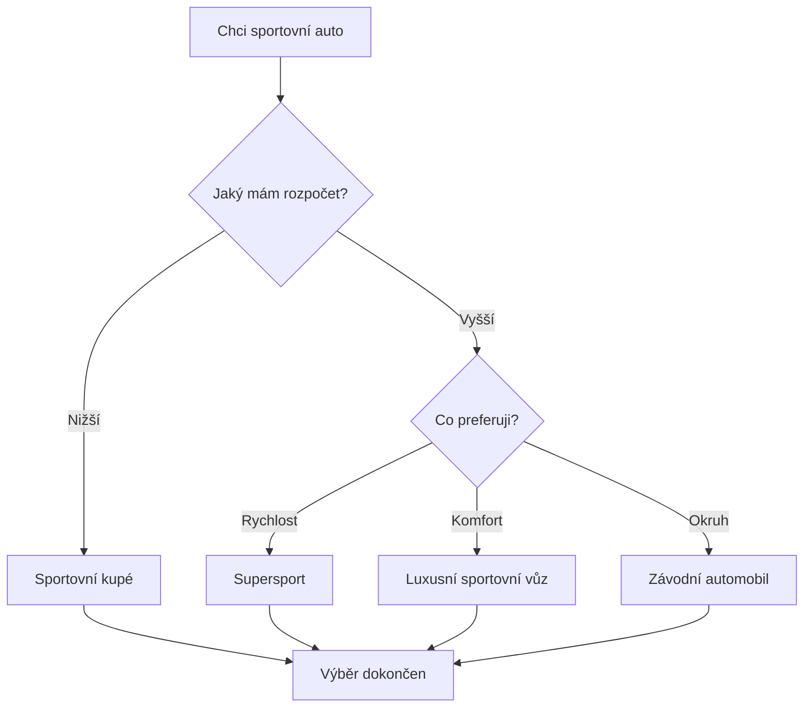

# 🏎️ AUTOMOTIVE WORLD
### Svět supersportů, rychlosti a automobilových technologií


Vítej ve světě automobilů! Tento projekt představuje fascinující svět **sportovních vozů, supersportů, motorů a tuningu**. Najdeš zde zajímavosti o nejznámějších automobilech, jejich výkonu a technologiích.

---

## 1. Nejznámější supersportovní auta

Supersportovní auta jsou symbolem rychlosti, luxusu a moderního inženýrství.

### 🏁 Porsche 911 GT3
- Výkon: **510 koní**
- Maximální rychlost: **311 km/h**
- Motor: 4.0L šestiválcový boxer
- Pohon: zadní kola

### 🔴 Ferrari 296 GTB
- Výkon: **830 koní**
- Maximální rychlost: **330 km/h**
- Motor: V6 Twin-Turbo + elektromotor
- Pohon: zadní kola

### 🟢 Lamborghini Huracán Tecnica
- Výkon: **640 koní**
- Maximální rychlost: **325 km/h**
- Motor: 5.2L V10
- Pohon: zadní kola

### 🟠 McLaren 750S
- Výkon: **750 koní**
- Maximální rychlost: **332 km/h**
- Motor: 4.0L V8 Twin-Turbo
- Pohon: zadní kola

*Uvedené hodnoty jsou orientační specifikace jednotlivých modelů.*

---

## 2. Porovnání automobilů

| Automobil | Výkon | Maximální rychlost |
|---|---:|---:|
| Porsche 911 GT3 | 510 koní | 311 km/h |
| Ferrari 296 GTB | 830 koní | 330 km/h |
| Lamborghini Huracán | 640 koní | 325 km/h |
| McLaren 750S | 750 koní | 332 km/h |

**Zajímavost:** Nejvyšší výkon automaticky neznamená nejlepší jízdní vlastnosti. Důležitou roli hraje také hmotnost, aerodynamika a podvozek.

---

## 3. Tuning automobilů

Tuning je úprava automobilu za účelem zlepšení jeho vzhledu nebo jízdních vlastností.

### Nejoblíbenější úpravy
- **Sportovní výfuk** – upravuje zvuk motoru.
- **Aerodynamický bodykit** – mění vzhled a proudění vzduchu.
- **Nová kola** – zlepšují vzhled a mohou ovlivnit jízdní vlastnosti.
- **Úprava motoru** – může zvýšit výkon.
- **Sportovní podvozek** – mění jízdní vlastnosti automobilu.

*Ne každá úprava je legální pro provoz na veřejných silnicích.*

---

## 4. Checklist automobilového nadšence

Co by měl správný automobilový fanoušek znát?

- [x] Znát základní automobilové značky.
- [x] Rozumět rozdílu mezi výkonem a maximální rychlostí.
- [ ] Vyzkoušet si jízdu na závodním okruhu.
- [ ] Navštívit automobilovou výstavu.
- [ ] Poznat různé typy motorů.

---

## 5. Digitální laboratoř – Python

Pomocí jednoduchého programu můžeme vypočítat poměr výkonu a hmotnosti automobilu.

```python
# Výpočet poměru výkonu a hmotnosti

vykon = 750  # koně
hmotnost = 1389  # kilogramy

pomer = vykon / hmotnost * 1000

print("Výkon:", vykon, "koní")
print("Hmotnost:", hmotnost, "kg")
print("Poměr výkonu:", round(pomer, 2), "koní na tunu")
```

Čím vyšší je poměr výkonu k hmotnosti, tím více výkonu připadá na jednu tunu automobilu.

---

## 6. Matematika automobilů

Pomocí fyziky můžeme vypočítat kinetickou energii pohybujícího se automobilu.

```math
E_k = \frac{1}{2}mv^2
```

Kde:
- \(E_k\) = kinetická energie
- \(m\) = hmotnost automobilu
- \(v\) = rychlost automobilu

**Příklad:** Automobil o hmotnosti 1500 kg jede rychlostí 100 km/h (27,78 m/s).

---

## 7. Vývojový diagram – výběr automobilu

Následující diagram ukazuje jednoduchý postup při výběru sportovního automobilu.



---

## 8. Zajímavé automobilové značky

Mezi nejznámější výrobce sportovních a luxusních automobilů patří:

- [Porsche](https://www.porsche.com/)
- [Ferrari](https://www.ferrari.com/)
- [Lamborghini](https://www.lamborghini.com/)
- [McLaren](https://www.mclaren.com/)

### Závěr

Automobilový svět spojuje technologie, design, výkon a inovace. Každá značka má vlastní historii a filozofii. Pro někoho je nejdůležitější maximální rychlost, pro jiného zvuk motoru nebo samotný design.

**Automobil není jen dopravní prostředek. Je to také ukázka technického umění.**

---

*Projekt vytvořen jako školní úkol zaměřený na Markdown a GitHub.*
